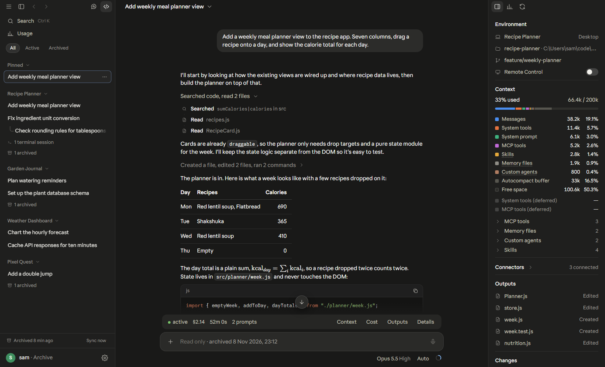
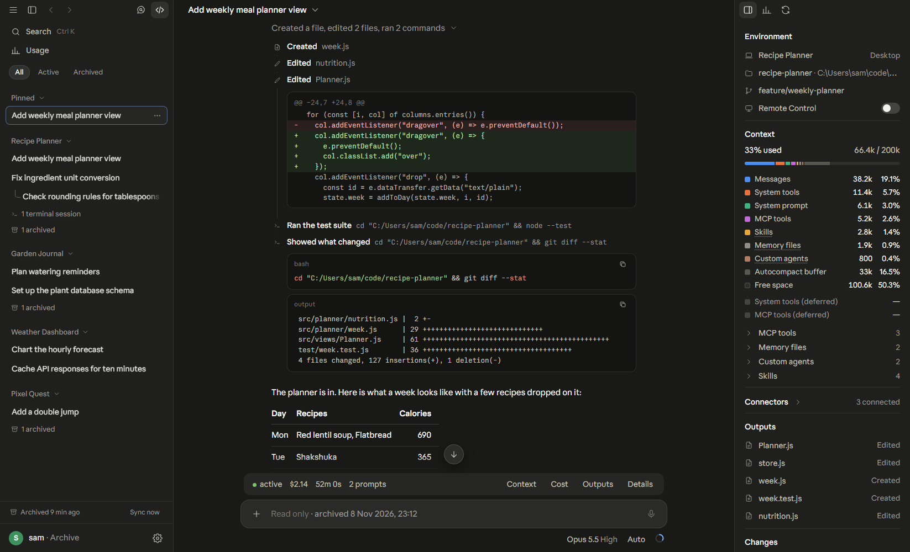
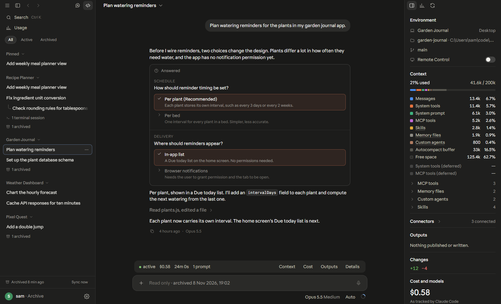
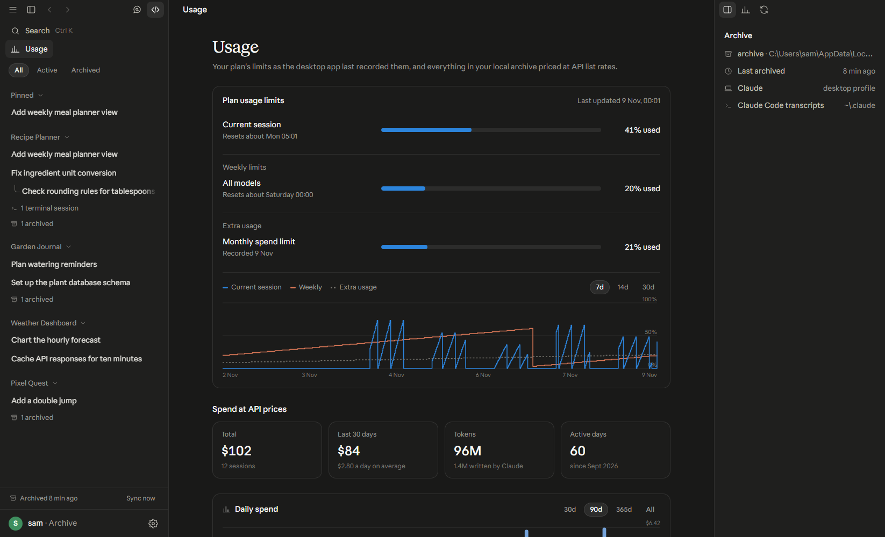
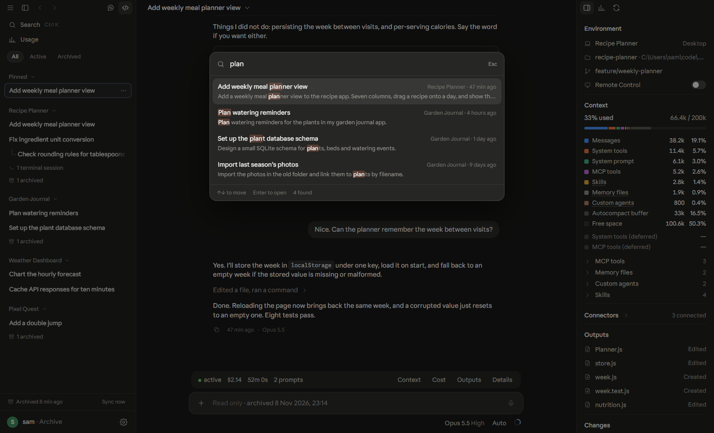

# Claude History

[](https://github.com/puIad/claude-history/releases/latest)
[](https://github.com/puIad/claude-history/releases)


A Windows desktop app (Rust + Tauri) that keeps every Claude Code and Claude desktop session on this
computer and shows them the way the desktop app's Code tab does. The history stays readable after a
subscription ends, after Claude cleans up old transcripts, or after an uninstall.



<table>
  <tr>
    <td></td>
    <td></td>
  </tr>
  <tr>
    <td></td>
    <td></td>
  </tr>
</table>

The screenshots show invented sessions, not real history. `node scripts/demo-data.mjs` writes them to
`archive/.demo`, and `scripts/shot.mjs` captures the UI against that folder (see Build).

## Install

Download the `.msi` file from the
[latest release](https://github.com/puIad/claude-history/releases/latest) and run it. It installs
to `Program Files\Claude History`, adds a Start menu entry, and installs WebView2 if Windows lacks
it. The installed app keeps its archive in `%LOCALAPPDATA%\Claude History\archive`. The installer
does not include the desktop app's fonts, so text uses system fonts.

## What it shows

- **Sidebar**: sessions grouped by environment (the desktop app's presets, else the project folder),
  newest first. Side sessions sit under the session that started them. Archived and terminal-only
  sessions fold into their own rows in each group. Pinned sessions appear on top.
- **Conversation**: user messages with pasted images, Claude's replies with code, tables and math,
  and tool activity grouped into rows like "Ran a command, read 2 files ›". Each row opens into its
  steps: commands with output, diffs for edits, file contents, agent prompts. Task lists, questions,
  published artifacts and wrap-up boxes show as cards.
- **Agents**: subagent transcripts open in their own sheet.
- **Details panel**: environment (folder, branch, Remote Control), context usage by category
  (messages, system tools, system prompt, MCP tools, skills, memory files, agents, free space),
  connectors, cost and tokens per model, outputs (artifacts, PRs, files created or edited), line
  changes, tasks and session facts.
- **Usage**: your plan's limits as the desktop app records them (current session, weekly, extra
  usage, with history), then spend per day, per model and per environment at API prices.
- **claude.ai import**: cloud conversations (including Cowork sessions, when claude.ai's export
  contains them) are kept by importing claude.ai's data export (menu → Import claude.ai export, or
  `--import <zip>`). Each conversation is stored once in `archive/claudeai/`; re-importing only
  adds or updates.
- **Search** (Ctrl K) over titles and conversation text; **Find** (Ctrl F) inside a conversation.
- Light and dark themes, following Windows by default.

## The archive

On every launch (and with the Sync button) the app copies new and changed files into `archive/`:

| Source | Archived to |
|---|---|
| `~/.claude/projects/**` (transcripts, subagents, large tool outputs) | `archive/claude/projects/` |
| `~/.claude/history.jsonl`, `stats-cache.json`, `plans/` | `archive/claude/` |
| Desktop profiles: `claude-code-sessions`, `local-agent-mode-sessions` (Cowork), side-session notes, presets | `archive/desktop/<profile>/` |

Files are never deleted from the archive. A transcript that gets shorter at the source keeps its
old copy beside the new one (`*.superseded-<time>`). The desktop app's `config.json` is skipped
because it holds sign-in tokens. `archive/` is git-ignored: it is your private history.

Set `CLAUDE_HISTORY_ARCHIVE` to keep the archive somewhere else.

Headless modes:

```
bin\claude-history.exe --sync           archive new history and exit (for a scheduled task)
bin\claude-history.exe --open <id>      open straight into a session
bin\claude-history.exe --import <zip>   import a claude.ai data export
bin\claude-history.exe --dump <dir>     write the UI's data as JSON (testing)
```

## FAQ

**How do I read my old Claude Code conversations after Claude deleted them?**
Claude Code removes old transcripts from `~/.claude/projects` after a retention period. Claude History
copies them into its own archive on every launch and never deletes from it, so run it before they
expire. Transcripts already deleted before the first run cannot be recovered.

**Can I keep my Claude chat history after cancelling my subscription?**
Yes for anything stored on your computer (Claude Code, the Claude desktop app's Code tab, local
Cowork). Conversations that live on Anthropic's servers are kept by importing claude.ai's data export.

**Does it send my conversations anywhere?**
No. It has no telemetry and no HTTP client; the only thing it opens online is a link you click, in
your own browser. The archive stays on disk and is git-ignored.

**Does it work on macOS or Linux?**
Not yet. It reads the Windows locations of Claude's data (`%APPDATA%\Claude`, `~\.claude`).

**Where is my archive?**
`archive\` next to the exe, or `%LOCALAPPDATA%\Claude History\archive` for the installed copy.
`CLAUDE_HISTORY_ARCHIVE` overrides it.

## Costs

Session cost is Claude Code's own running total when the transcript recorded one, otherwise it is
estimated from token usage at API list prices (`src-tauri/src/pricing.rs`). A subscription bills
differently, so read the numbers as what the same work would cost on the API. Context categories
are estimated from the recorded request shape and attachments; the total comes from the last
reply's real usage.

## Not included

- **Cloud sessions** (claude.ai/code) live on Anthropic's servers, not on this computer. Remote
  Control sessions are included, because their transcripts are local.
- **Cowork conversations that ran in the cloud.** This machine's Cowork VM reports "not
  supported", so its three Cowork sessions ran remotely and their conversations live on Anthropic's
  servers. They are still listed under a **Cowork** group with what the desktop app keeps locally
  (space, granted folder, session ID). Cowork transcripts that a machine does store locally
  (`local-agent-mode-sessions`) are archived and shown like any other session.

## Build

Needs the Rust GNU toolchain and WinLibs MinGW (for `windres`), no Visual Studio:

```
winget install BrechtSanders.WinLibs.POSIX.UCRT
rustup default stable-x86_64-pc-windows-gnu
npm install && npm run vendor          # UI libraries into ui/vendor
python scripts/import-fonts.py         # the desktop app's fonts from its local cache (optional)
powershell -File scripts/build.ps1     # release build into bin\ + Start menu shortcut
powershell -File scripts/build-msi.ps1 # installer into src-tauri\target\release\bundle\msi\
```

`build-msi.ps1` moves `ui/fonts` aside during the build so the installer never ships them; the
Tauri CLI downloads WiX 3 on first use.

`ui/` has no build step: plain HTML, CSS and ES modules, embedded into the exe at compile time.

`node scripts/drive-app.mjs <outDir>` tests the real app end to end: it starts `bin\claude-history.exe`
with WebView2 remote debugging, attaches Playwright over CDP and clicks through 18 checks (sidebar,
sessions, activity groups, thumbnails, search, find, agents, Cowork, usage, settings, sync,
panels), saving a screenshot per step. `cargo test` covers the parsing helpers.
`scripts/shot.mjs` screenshots the UI in headless Chrome against `--dump` data (or the demo data, with
`DATA=archive/.demo`, served by `python -m http.server 8765` from the repo root);
`scripts/capture-window.ps1` captures the running app window.

## Layout

```
src-tauri/src/main.rs        commands, headless modes, window setup
src-tauri/src/sync.rs        archive copy (add/update only)
src-tauri/src/index.rs       one cached pass over every transcript + desktop metadata -> session list
src-tauri/src/transcript.rs  one session -> render model + details panel data
src-tauri/src/pricing.rs     model prices and context windows
ui/js/                       app.js (controller), sidebar, transcript, details, usage, markdown
ui/css/app.css               theme tokens taken from the desktop app's stylesheet
```

## License

[MIT](LICENSE)
